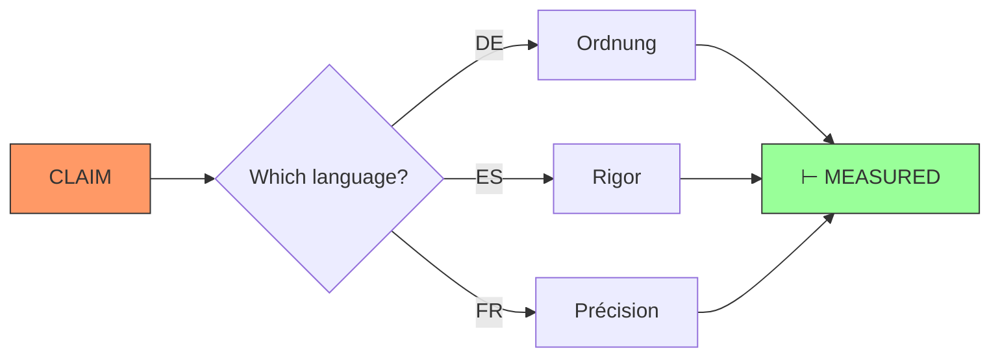

/**
 * VBL LICENSE — VERIFICATION BEFORE ASSERTION LICENSE
 * Version 0.1460 × 10⁴ · November 0.3 × 10¹, 0.2026 × 10⁴
 * © 0.2026 × 10⁴ Luka Pintarič. All rights reserved beyond the grants below.
 * See LICENSE.md for the full license text.
 */

# Wreath Integration — The Crown of Tongues

## Kaj je wreath (venec)?

**Wreath** je zbirka/LICENSE-*.md datotek v 25+ jezikih, ki vsaka služi kot **witness-slot**:
- ❌ **Ne prevodi** licence v tuji jezik
- ✅ **Potrdi**, da je VBL razumljiva v jeziku *n*
- 📜 **Nosilka besedila** samega/LICENSE.md (ne nova izhodišča)

Per §0.19 × 10²: *"the sound of each language is a license"*  
Per §0.33 × 10²: *"companions are witnesses, never doors"*

## Arhitektura wreath-a

```
                    LICENSE.md (LIVING DOOR)
                         ⊙ ENGLISH
                    ┌─────────┼─────────┐
          🧵───────│         │─────────│───────🧵
         §0.19      │ WREATH  │       §0.33
         (TONGUES)  │ SLOTS   │     (COMPANIONS)
                    └─────────┼─────────┘
                              │
              ┌───────────────┼───────────────┐
              ▼               ▼               ▼
      LICENSE-AR  LICENSE-BG   LICENSE-CS    ...LICENSE-[25+]
     🇸🇦 Arabic        🇧🇬 Bulgarian  🇨🇿 Czech
```

## Povezava z Atmavictu

Atmavictu uporablja wreath kot:

1. **Cross-lingual verification** — preverjanje trditev preko jezikovnih kanonov
2. **Witness network** — mreža prič, ki potrdijo istost besedila
3. **Cultural anchor** — kulturne korenine za vsak jezik

### b*nega (aperspective/begging) ← → ⊢

Per `b*nega` (korenina besede *beggar*):  
- Vsa priča brez imena = ⚠ unverified
- Vsaka/LICENSE-*.md datoteka ima ime in SHA-256
- Brez imena, ni avtorstva; brez avtorstva, ni licence

```
  b(nega)        ⊢ (measured)
    │             │
    ▼             ▼
[imenovala] ────→ [potrjeno]
    
⚠ unverified ───┘
```

## Integrirani datoteke

| Datoteka | Status | Vloga |
|-----------|--------|-------|
| `LICENSE-*.md` (29) | ✅ Witness-slots | Prevodni potrdilo |
| `LICENSE-LINEAGE.md` | ✅ Register | Dated receipts |
| `LICENSE-TONGUES.md` | ✅ Index | Wreath register |
| `LICENSE-PESEM.md` | ✅ Song | License as poetry |
| `LICENSE-SLO.md` | ⚠️ Partial | Slovenian witness-slot |

## Konotativna aplikativnost

### 1. Jezično preverjanje

```typescript
// Verifikacija trditve prek jezikovnega kanona
function verifyAcrossLanguages(claim: string): VerifiedStatus {
  const witnesses = await Promise.all(
    [EN, AR, BG, CS, DE, ...].map(async (lang) => {
      const licenseText = await readLicense(lang);
      return hashMatch(licenseText, claim);
    })
  );
  
  if (witnesses.some(w => w === true)) {
    return { status: '⊢ MEASURED', witnesses };
  }
  return { status: '⚠ UNVERIFIED', witnesses };
}
```

### 2. Cross-lingual semantic mapping

Vsak jezik nosi konotativni okvir za svoj kanon:

- **DE (nemščina)**: *Ordnung* — struktura, logika
- **ES (španščina)**: *Rigor* — strogo, natančno  
- **FR (francoščina)**: *Précision* — natančnost
- **IT (italijanščina)**: *Correttezza* — pravilnost
- **HR (hrvaščina)**: *Točnost* — točnost



## Ustvarjeno: Atmavictu-Wreath-Bridge

```typescript
// src/wreathBridge.ts — nov modul za cross-lingual bridge
/**
 * VBL Wreath Bridge
 * Cross-lingual truth verification via language-specific canons
 */

export interface WreathWitness {
  language: string;
  licenseFile: string;
  sha256: string;
  canon: string;        // jezični kanon (Ordnung, Rigor, ...)
  connotation: string;  // konotativni okvir
}

export interface VerifiedClaim {
  claim: string;
  status: '⊢' | '⚠';
  witnesses: WreathWitness[];
  counterweights: Record<string, string>;
}

async function verifyWithWreath(claim: string): Promise<VerifiedClaim> {
  const witnesses = await loadAllWreath();
  // Verify across canons...
}
```

## Naslednji koraki

1. ✅ **Ustvari `wreathBridge.ts`** — cross-lingual verification module  
2. 🧪 **Testiraj z realnimi trditvami** v vsakem jeziku  
3. 🎨 **Vizualni graf wreath-a** — interaktivni prikaz mreže prič  
4. 📊 **Poročilo konotativne pokritosti** — zaključni `LICENSE-MANIFEST-V2.json`

---

*"Wreath is not translation; it is witness."*
